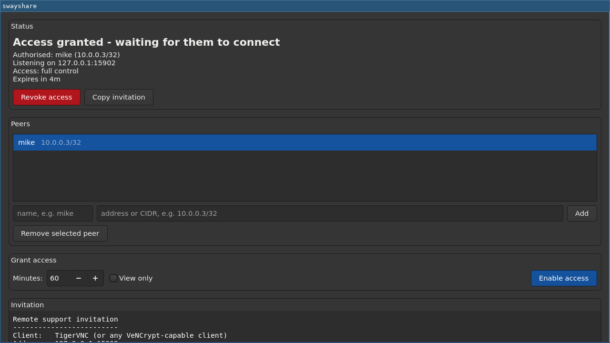

# swayshare

Temporary, peer-scoped remote desktop access for [Sway](https://swaywm.org),
[Hyprland](https://hypr.land) and other
[wlroots](https://gitlab.freedesktop.org/wlroots/wlroots)-based Wayland
compositors — a "helping hands" tool for when someone you trust needs to sit
down at your machine and fix something with you.

Nothing in swayshare is Sway-specific: it supervises `wayvnc`, which runs on
any compositor that implements the wlroots screencopy and virtual
pointer/keyboard protocols. Sway is the reference target; Hyprland is tested
and works.

This is not screen sharing in the presentation sense. The person you invite
gets a **working desktop**: your screen, your pointer and your keyboard, live
and under their control, at the same time as you. You both drive. That is the
point — it is how someone talks you through a problem by just doing it — and
it is also why the access controls here are as strict as they are.

There is also a **view-only** mode, for when someone needs to look but not
touch. It is chosen when you grant access, and fixed for that session; see
[why](#why-view-only-is-fixed-per-session).

[wayvnc](https://github.com/any1/wayvnc) carries the desktop. swayshare
decides *who* may reach it, *when*, and for *how long*, and it needs no root
privileges and no firewall changes to do that.

## Why this has to be installed software

There is no way to do this from a web page, which is why swayshare is a
program you install rather than a link you open.

Capture is the half that nearly works in a browser: `getDisplayMedia` can grab
your screen through a desktop portal. But sending a *picture* of your desktop
is only presentation-style screen sharing. The moment the other person needs
to actually type and click, a browser cannot help — **no web API can inject
input into your compositor.** That is a deliberate sandbox boundary, not an
oversight: a web page that could move your pointer and press your keys would
be a universal remote-code-execution primitive on every machine that loaded
it. Injecting into Sway means speaking wlroots' virtual-pointer and
virtual-keyboard protocols as a native client on your seat, which is exactly
what wayvnc does and what no page in a tab can do.

## How it works

wayvnc is started on a Unix-domain socket inside a 0700 runtime directory, so
it has no network presence at all. swayshare binds the only TCP listener and
forwards connections to that socket — but only from the single peer you have
authorised:

```
  Mike's VNC client                 your machine
  10.0.0.3                          ┌──────────────────────────────────┐
      │                             │  swayshare gate                  │
      │   existing WireGuard        │  10.0.0.10:5900                  │
      └────────── tunnel ──────────►│    ↓ source in 10.0.0.3/32 ?     │
                                    │    ↓ arrived over wg0 ?          │
                                    │    ↓ under the connection limit? │
                                    │  ──────────────────────────────  │
                                    │    ↓ $XDG_RUNTIME_DIR/swayshare/ │
                                    │      vnc.sock  (0700, no TCP)    │
                                    │    ↓                             │
                                    │  wayvnc  ⇄  Sway                 │
                                    │  (screen out, input in)          │
                                    └──────────────────────────────────┘
```

The arrow runs both ways: frames go out to Mike, and his key presses and
pointer motion come back in and are injected into your Sway session as if
they came from your own keyboard and mouse.

The gate forwards bytes verbatim, so wayvnc's own authentication and
encryption run end to end between Mike's client and wayvnc. swayshare never
holds the session key material in a form it could use to read the stream or
inject input of its own.

Two independent rules have to pass, not one. A connection is admitted only if
its source address is inside the peer's CIDR **and** that address reaches the
machine over the configured interface. Either rule alone would be a single
point of failure; together, a mistyped CIDR is contained by the interface
check, and a route that should not exist is contained by the CIDR.

This is an *additional* restriction layered on top of your VPN and host
firewall, not a replacement for either. The host firewall must already permit
the port over the tunnel.

## Status

All three planned milestones are implemented: the CLI, the tray applet, and
the GTK4 configuration window.



## Install

On NixOS:

```sh
nix run github:enigmacurry/swayshare -- status      # try it
nix profile install github:enigmacurry/swayshare    # keep it
```

There are two packages: `swayshare` includes the GTK4 configuration window,
and `swayshare-cli` is the same binary built without it, for machines that do
not want GTK.

A statically linked `swayshare-cli` is attached to each
[release](https://github.com/EnigmaCurry/swayshare/releases) — one file, no
runtime dependencies of its own, though it still needs `wayvnc` on `PATH`:

```sh
tar xzf swayshare-cli-*-x86_64-linux-musl.tar.gz
sudo install -m0755 swayshare-cli-*/swayshare /usr/local/bin/
```

Or from crates.io, where the GUI needs GTK development headers and the CLI
does not:

```sh
cargo install swayshare                        # with the window
cargo install swayshare --no-default-features  # CLI and tray only
```

From source — `wayvnc` 0.10 or newer must be on `PATH`:

```sh
nix develop            # GTK, wayvnc, sway/hyprland, just and the test tooling
just build             # with the configuration window
just build-cli         # without it, and therefore without needing GTK
```

## Quickstart

```sh
# Tell swayshare where to listen. Peers are reached over your own VPN;
# swayshare does not manage the tunnel.
$EDITOR "$(swayshare config-path)"

# Record the people you would be willing to hand the controls to.
swayshare add mike 10.0.0.3/32
swayshare add jane 10.0.0.4          # a bare address becomes a /32
swayshare list

# Hand Mike the controls for 30 minutes, and print an invitation to send him.
swayshare start mike --minutes 30

# ...or let him watch without being able to type or click.
swayshare start mike --minutes 30 --view-only

# Check on it, or take them back the moment you are done.
swayshare status
swayshare stop
```

`swayshare start` prints everything the remote user needs:

```
Remote support invitation
-------------------------
Client:   TigerVNC (or any VeNCrypt-capable client)
Address:  10.0.0.10:5900
Username: support
Password: EXAMPLE0PASSWORD0NOT0REAL0
TLS cert: SHA256:5C:A1:F9:4B:...

You will have full control of the screen, keyboard and pointer,
at the same time as me. Connect through the VPN tunnel. The
password is valid for this session only, and only connections
from your own address are accepted (10.0.0.3/32).
Access expires automatically in 30m.
```

**Client choice matters.** wayvnc wraps the session in VeNCrypt x509 TLS plus
a password. [TigerVNC](https://tigervnc.org) (`vncviewer`) is the tested,
recommended client. Remmina's VNC plugin is unreliable with this auth scheme
— it tends to get stuck prompting for CA/client certificates. With TigerVNC
you only need the server's self-signed cert; no client certificate is used.

### The tray applet

```sh
swayshare tray
```

The tray shows a monitor glyph in one of five states:

| Glyph | Meaning |
|---|---|
| grey, empty | nobody has access |
| amber, empty | a peer is authorised but has not connected |
| cyan, empty | a connection is open but has **not authenticated** yet — nothing is shared |
| blue, with a dot | authenticated, **view only** — they can see but not type |
| red, filled | authenticated with **full control** |

Connecting and authenticating are kept apart on purpose. A bare TCP
connection — which is also what a port scan or a wrong-password attempt looks
like — shows as the quiet cyan glyph and does **not** raise the bar's
attention state, because nothing is on anyone's screen until the password is
accepted. Only once a client authenticates does the glyph turn blue or red and
the bar demand attention.

The states differ in shape as well as colour, so the two distinctions that
matter — whether anyone is actually in, and whether they can type — survive
not being able to tell blue from red. Both authenticated states are reported
to the bar as needing attention and will not be quietly hidden: a view-only
peer still sees everything on your screen.

Its menu has one submenu per access mode — *Hand the controls to* and *Grant
view-only access to* — and entries to copy the invitation, revoke access, and
open the configuration window. Quitting the tray revokes access and stops the
daemon.

It hosts a daemon itself when none is running, and attaches to one if there
is. Because the icon is drawn in code rather than looked up in an icon theme,
it cannot silently fail to appear for want of a theme icon; and because it
keeps retrying to register, starting before your bar does is harmless.

To autostart it from your Sway config:

```
exec swayshare tray
```

### The configuration window

```sh
swayshare gui
```

Add and remove peers, pick how long access should last, choose whether the
session is view-only, hand the controls to the selected peer, and copy the
invitation. It talks to the same daemon as
everything else, so a session started from the tray or the CLI shows up here
too, invitation included. Closing the window leaves the tray and any running
session alone.

### Sway integration

Sessions are started from the CLI or the tray applet. `swayshare status --json`
is meant for a status bar:

```json
{"state":"authenticated","peer":"mike","cidr":"10.0.0.3/32",
 "listen":"10.0.0.10:5900","connections":1,"authenticated":1,
 "expires_in_seconds":1583}
```

`state` is one of `off`, `listening`, `connected`, or `authenticated`.
`connected` means a TCP connection is open but has not passed the password, so
nothing is shared yet; `authenticated` means a client is actually in. The
`connections` field counts open connections and `authenticated` counts how
many of those have logged in.

While someone else is driving, your own Sway bindings still reach Sway — their
input and yours are merged into the same seat. If you want to stop your
modifier key being swallowed by the remote application, wayvnc's man page
suggests an almost-empty passthrough mode; see its FAQ.

The mirror of that problem is on the *viewing* side: when you run `vncviewer`
inside your own Sway session and the remote desktop is itself a Sway, your
local Sway catches every `$mod` binding before it reaches the viewer, so those
keys never make it through to the remote compositor. Put your **local** Sway
(the one hosting the `vncviewer` window) into a passthrough mode that forwards
every key to the focused window until you explicitly leave it, and bind the
toggle to a key that no compositor claims — `$mod+Pause` works well:

```
# In your *local* Sway config (the client hosting the vncviewer window):
mode passthrough {
    # Leave passthrough: give bindings and the floating modifier back.
    bindsym $mod+Pause mode default; floating_modifier $mod normal
}

# Enter passthrough: forward $mod to the focused window, i.e. into vncviewer.
bindsym $mod+Pause mode passthrough; floating_modifier none
```

`floating_modifier none` while in passthrough stops your local Sway from
intercepting `$mod`+drag, so those events reach the remote Sway too.
`$mod+Pause` flips the mode back and restores normal `$mod` handling.

### Why view-only is fixed per session

Because wayvnc only accepts `--disable-input` at startup. Its control socket
(`wayvncctl`) has no command to change input handling on a running server, so
switching mid-session would mean restarting wayvnc and dropping the peer's
connection.

Two other routes were tried and rejected:

- `swaymsg input <device> events disabled` on wayvnc's virtual devices. They
  *do* appear while a client is connected, and sway returns `success: true` —
  but the keys still arrive. `events disabled` maps to a libinput call, and
  virtual devices have no libinput backing. It looks like it works, which
  makes it worse than not working.
- `wayvncctl detach`. It terminates the session rather than pausing it.

A toggle that silently disconnects the other person would be a poor control,
so the choice is made when access is granted instead. If you need to stop
someone *now*, `swayshare stop` is instant and unambiguous — that is the
emergency brake, and a mode switch is not.

## Configuration

`~/.config/swayshare/config.toml`:

```toml
[network]
# Confine access to this interface. Its current address is what the gate binds
# to - resolved at every session start, so a tunnel that comes and goes is
# picked up each time - and every connection must also arrive over it.
interface = "wg0"
# Optional: bind somewhere specific. This overrides where the gate *binds*,
# but the `interface` requirement above still applies to who gets in, so
# setting both is a sensible combination. Setting only `address` turns the
# interface check off and leaves the CIDR standing alone.
# address = "10.0.0.10"
port = 5900

[security]
max_connections = 1
default_session_minutes = 60   # 0 disables automatic expiry
username = "support"

[[peers]]
name = "mike"
cidr = "10.0.0.3/32"

[[peers]]
name = "jane"
cidr = "10.0.0.4/32"
```

### Why binding to the interface's address is not enough

Setting `interface = "wg0"` makes the gate bind wg0's address, but on Linux
that does not confine traffic to wg0. The kernel uses the weak host model: a
packet addressed to the wg0 address is accepted arriving on *any* interface,
so with `rp_filter` loose or off, something from eth0 can reach a listener
"on" wg0. The CIDR would then be the only thing left between the internet and
wayvnc.

So the gate checks the route as well. For each connection it asks the kernel
which interface the source address would be reached through, and refuses
anything that does not come back as the configured one. An address the kernel
cannot route at all is refused too — the check fails closed.

The lookup needs no privileges: connecting a UDP socket sends nothing, it just
makes the kernel run its routing decision and pin the result, which
`getsockname` then reveals. `SO_BINDTODEVICE` would be more direct but
requires `CAP_NET_RAW`, which this program deliberately does not hold.

`max_connections = 1` is the default for two reasons: one more person with
your keyboard is a deliberate decision each time, and two remote clients
fighting over a single pointer is unusable anyway.

Session passwords are never written here. They live only in a 0600 file in
`$XDG_RUNTIME_DIR/swayshare/`, which is erased when the session ends.

If neither `interface` nor `address` is set, swayshare refuses to start a
session rather than falling back to a wildcard bind. The same applies when a
configured interface has no address: a tunnel that is down is reported, never
worked around.

## Security model

The thing being granted is **control of your desktop**, not a view of it. A
peer who connects can type, click, read anything on screen, open a terminal
and run commands as you. Everything below follows from taking that seriously.

What swayshare guarantees:

- **Off by default.** The daemon starts with no listener bound, and returns to
  that state on stop, on expiry, if wayvnc dies, if the gate fails, and on
  exit. There is no path that leaves a listener up without an authorised peer.
- **Two independent rules, not one.** A connection must satisfy both the
  peer's CIDR and the interface requirement. Neither is load-bearing on its
  own, so a mistake in one does not open the door.
- **One peer at a time.** Handing the controls to a different person tears
  down the current session and mints a new password first.
- **Immediate revocation.** `stop` closes the listener *and* drops connections
  that are already established — it does not wait for the other person to
  disconnect, and it does not ask them.
- **Fresh credentials per session.** 130 bits of entropy from the system
  CSPRNG, zeroized in memory on drop and deleted from disk on stop.
- **A stable server identity.** The TLS key pair is generated once and kept,
  so the remote user sees the same fingerprint every time and can pin it. Only
  the password rotates.
- **Authentication is not optional.** wayvnc is configured so that the "None"
  security type is never offered; `scripts/e2e-smoke.sh` asserts this against
  a real wayvnc.
- **You can always see when someone is driving.** The tray icon changes and a
  desktop notification fires on every connect and disconnect, and both say
  whether the peer can type or only watch.
- **View-only is enforced by wayvnc, not by politeness.** The session is
  started with `--disable-input`, so the input path does not exist for the
  duration; `scripts/e2e-smoke.sh` proves a real authenticated client's key
  press reaches Sway in a control session and does not in a view-only one.
- **No privileges.** No root, no setuid, no firewall mutation. Access control
  is entirely in userspace, which is also why it is portable across distros.
- **One set of rules.** The tray and the window are clients of the same
  control socket as the CLI; neither has a privileged path of its own, and
  neither can enable a peer the daemon would refuse.

What it does **not** do:

- **In a full-control session it does not limit what the other person can
  do.** They have the same keyboard and pointer you do. There is no prompt
  before each action and no audit log of what they did. Apart from choosing
  view-only, the only controls are *who*, *when*, and *for how long* — so
  invite people you would hand an unlocked laptop to, and nobody else.
- **View-only still shows them everything.** Input is dropped, but every
  window, password manager and private message on screen is visible. It is a
  limit on what they can *do*, not on what they can *see*.
- It does not manage your VPN. Peers must already be reachable through it.
- It does not defend against a peer whose address has been taken over by
  someone else *on the tunnel itself*. Access control is only as strong as the
  tunnel underneath it, which is why `/32`s and WireGuard are the intended
  setup. The interface requirement narrows this to "someone who is already a
  valid peer on that interface" rather than "anyone who can route a matching
  source address to you", but it cannot distinguish two peers inside the same
  tunnel.
- The interface check uses the route *back* to the peer, not the interface the
  packet physically arrived on — there is no unprivileged way to ask that for
  a TCP connection. The two differ only under asymmetric routing.
- Ranges wider than a `/24` are refused outright; a `/24` warns. "One named
  person" is the unit of trust here, and a subnet is not that.

## Packaging

The two build shapes have very different dependency profiles, and that is what
decides how each is best distributed:

| | CLI + tray (`--no-default-features`) | Full build |
|---|---|---|
| Shared libraries | 5 — libc, libm, libgcc_s, vdso, ld.so | 106 |
| Nix closure | 436 MB | 1008 MB |

The tray and the notifications link nothing beyond libc: `ksni` and
`notify-rust` speak D-Bus over the socket in pure Rust. So the CLI build
targets musl cleanly and becomes a single self-contained file, which is what
the release workflow ships. The GTK build is deliberately *not* published as a
binary — a dynamically linked GTK application is not portable, and that is
what distribution packaging is for.

- `packaging/aur/PKGBUILD` builds the full package, with a commented block
  showing the two-line change for a `swayshare-cli` variant.
- `.github/workflows/ci.yml` runs `just check` on the master branch and on
  every pull request, plus the static build and a dependency audit.
- `.github/workflows/release.yml` runs `just check` and `just package` on a
  tag, asserts the binary really has no dynamic dependencies, and publishes
  it with the source-tarball checksum the AUR package needs.

Both call the Justfile rather than inlining cargo commands, and both use only
`actions/checkout`, `actions/cache` and the preinstalled `gh` CLI. `just`
itself is installed by a local composite action: this is the build path for a
tool that grants remote control of a desktop, so third-party actions are kept
out of it.

Whatever route you take, express **wayvnc ≥ 0.10** as a hard dependency.
swayshare relies on `--unix-socket`, `--disable-input` and the
`enable_auth`/`private_key_file` config keys; without them the failure is a
confusing runtime error rather than a refused install.

### Why not AppImage or Flatpak

AppImage would bundle GTK, which is the one genuinely heavy dependency — but
it cannot bundle the one that matters. wayvnc pulls in libdrm, gbm/mesa and
ffmpeg/VA-API, and captures through DMA-BUF straight from the compositor, so a
bundled copy would have to interoperate with the host's kernel DRM and GPU
driver. That is the classic AppImage failure mode. Leave wayvnc out and the
image is no longer self-contained: the user installs it from their package
manager anyway, at which point the AppImage bought nothing. Bundling GTK would
also make this project responsible for shipping GTK security updates, in a
tool whose job is handing someone else control of a desktop.

Flatpak is a worse fit still. The design deliberately avoids portals — wayvnc
needs `wlr-screencopy` and the virtual-keyboard and virtual-pointer protocols
directly — so it would take enough sandbox holes to defeat the point.

## Development

The Justfile is the entry point, and CI calls the same recipes, so what runs
on a pull request and what you run locally cannot drift apart.

```sh
just                   # list every recipe
just check             # fmt, clippy and tests in BOTH feature sets - the CI gate
just run status        # build and run with arguments
just daemon            # run the supervisor in the foreground
just tray              # run the tray applet
just gui               # open the configuration window
just smoke             # all three smoke suites (needs nix develop)
just package           # build the release tarball exactly as CI does
```

Releasing follows two steps, so the version bump goes through a pull request
and CI before anything is tagged:

```sh
just bump-version          # or: just bump-version minor | major | 1.2.3
                           # makes a release-vX branch; push it and open a PR
just release               # from master, once merged: audits, tags and pushes
```

`bump-version` keeps `Cargo.toml`, `Cargo.lock` and the AUR `PKGBUILD` in
step, and `release` refuses to tag if they have drifted apart.

## Testing

```sh
just test              # with the GTK window
just test-cli          # without GTK - the window's state machine still runs
just test-all          # both
nix develop -c just smoke   # the three suites below
```

- `e2e-smoke.sh` (`just e2e`) runs a real wayvnc on a headless Sway and drives it with
  `scripts/vnc_client.py`, a minimal VeNCrypt client written for these tests
  because no command-line viewer will take a VeNCrypt password
  non-interactively. It completes a genuine X509Plain + TLS 1.3 handshake,
  verifies the server certificate against swayshare's own stored cert, and
  authenticates with the generated password. The script then checks that a
  wrong password is refused, that an unauthorised source address receives no
  bytes at all, that a full-control session's key press reaches Sway while a
  view-only session's does not, that a connection whose CIDR matches is still
  refused when it does not arrive over the required interface — and admitted
  once the real interface is named — that stop revokes immediately, and that
  no credentials are left behind.
- `tray-smoke.sh` (`just tray-smoke`) runs the tray on a bus created by `dbus-run-session`, so it
  never touches your real tray, and asserts over D-Bus that the item
  registers, that its icon and `Status` track the session, that a connected
  view-only session renders a different icon from a connected full-control
  one, that the menu reflects the state, and that quitting revokes access and
  stops the daemon.
- `gui-smoke.sh` (`just gui-smoke`) opens the window on a headless Sway and checks that it maps,
  renders, and follows the daemon's state. A headless wlroots seat has no
  input devices, so synthetic clicking is not possible there - which is why
  the window's behaviour lives in `src/window.rs` as a plain state machine
  with no GTK in it. `reduce()` folds an event into the model and returns the
  effects to perform, so every control can be exercised directly: what a click
  on *Add* does with a malformed CIDR, that a selection left pointing past the
  end of a shortened peer list is dropped rather than reinterpreted, that an
  invitation is fetched once per session and not once per poll. Those tests
  need no display at all, and run in the `--no-default-features` build too.
  `src/gui.rs` is then only the translation between that model and GTK, with a
  single `render()` that writes the whole model onto the widgets.

## Roadmap

1. **CLI** — done.
2. **Tray applet** — done: a StatusNotifierItem (`ksni`) for Waybar, with peer
   selection, a connection indicator and one-click stop.
3. **Configuration window** — done: a GTK4 peer editor with invitation
   copying and expiry settings.

Possible next steps:

- Subscribe to daemon events over the control socket instead of polling once a
  second, so the tray and window react instantly.
- Use wayvnc's own control socket (`wayvncctl`) to expose per-client detail.
  Note that it reports `address: null` for Unix-socket clients, so the gate
  remains the only source of connection identity.
- Let the window edit `network.interface` / `port`, which today still means
  editing the config file.
- Cross-check peer CIDRs against the tunnel's own peer list (for WireGuard,
  `wg show <iface> allowed-ips`) so an unroutable CIDR is a startup error
  rather than a rule that silently never matches. Deliberately not done in the
  interface check itself, which stays VPN-agnostic.
- A mid-session view-only switch, if wayvnc ever grows a control-socket
  command for it. Doing it today would mean disconnecting the peer.

Deliberately out of scope: managing the WireGuard tunnel itself.

## License

MIT
